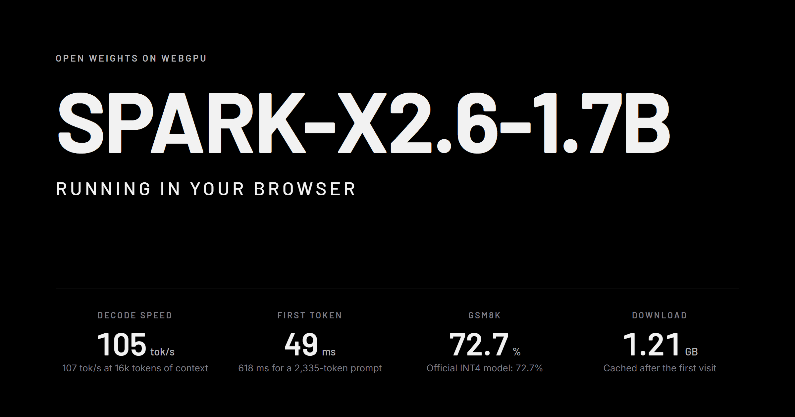
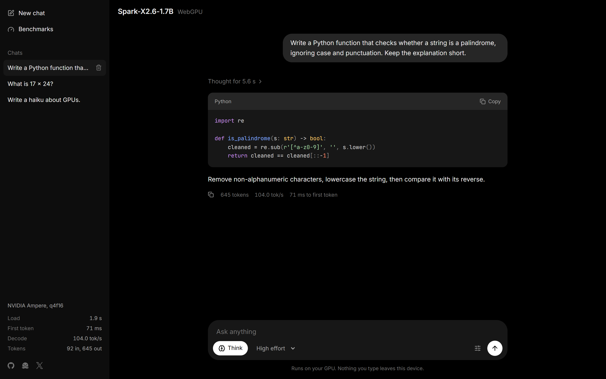
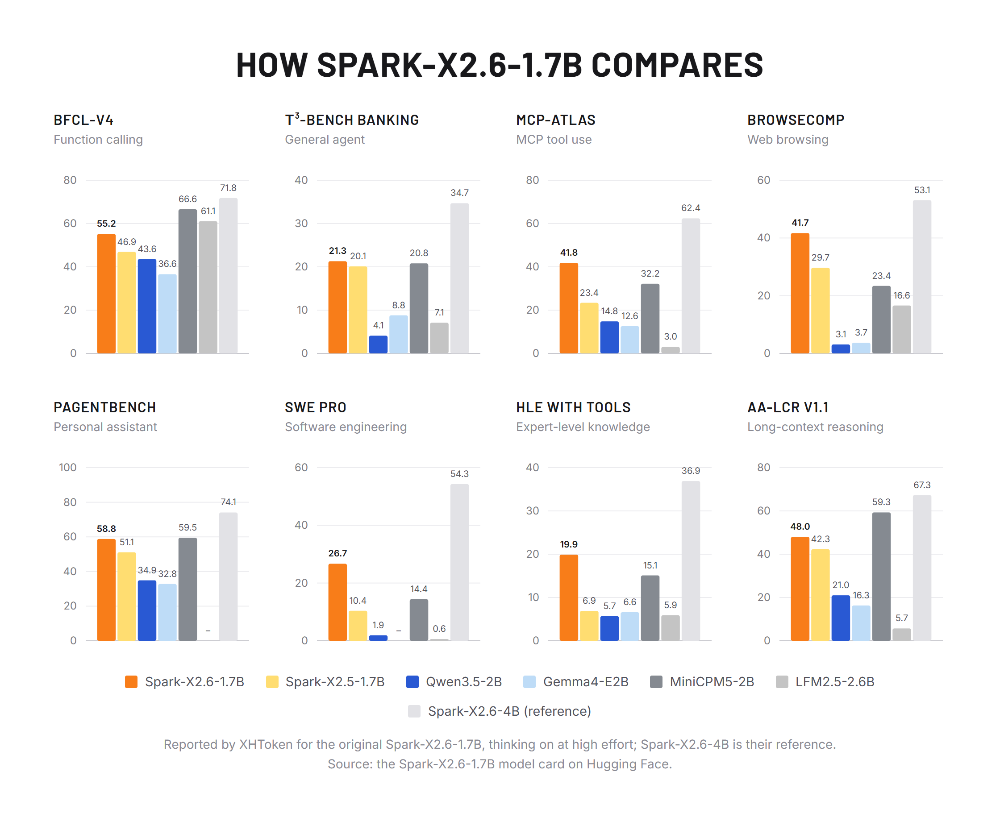
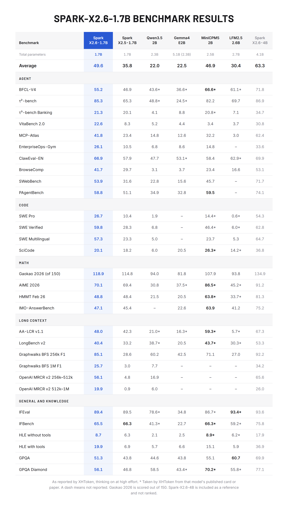
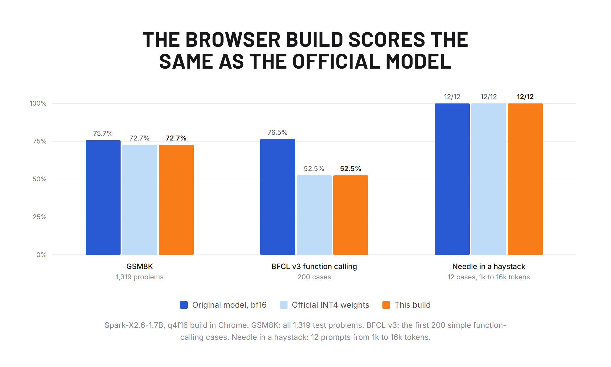
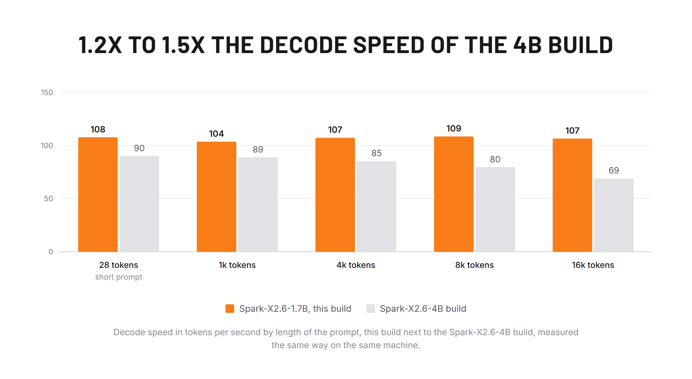

# Spark-X2.6-1.7B for WebGPU

[](https://huggingface.co/spaces/mohdmahmodi/Spark-X2.6-1.7B-WebGPU)
[](https://huggingface.co/mohdmahmodi/Spark-X2.6-1.7B-ONNX-WebGPU)
[](LICENSE)
[](docs/VALIDATION.md)
[](https://onnxruntime.ai/docs/tutorials/web/)
[](#with-transformersjs)
[](https://github.com/microsoft/onnxruntime/pull/33760)



[XHToken/Spark-X2.6-1.7B](https://huggingface.co/XHToken/Spark-X2.6-1.7B), the 1.7-billion-parameter Spark model,
converted to 4-bit ONNX and running entirely in the browser on WebGPU. No server, no install, no data leaves the device.

- [Live demo](https://huggingface.co/spaces/mohdmahmodi/Spark-X2.6-1.7B-WebGPU)
- [Model files on Hugging Face](https://huggingface.co/mohdmahmodi/Spark-X2.6-1.7B-ONNX-WebGPU)
- [Validation report](docs/VALIDATION.md)

| Model | Format | Runtime | Status |
|---|---|---|---|
| [Spark-X2.6-1.7B](https://huggingface.co/mohdmahmodi/Spark-X2.6-1.7B-ONNX-WebGPU) | ONNX, 4-bit weights (q4f16, q4) | onnxruntime-web, WebGPU | released, validated |

- **Accurate.** Same scores as the official INT4 checkpoint in transformers: GSM8K 72.7%, BFCL function calling
  52.5%, needle in a haystack 12/12. The build adds a mean KL divergence of 0.00085 on top of the quantization.
- **Fast.** About 105 tokens per second at any context length up to 16k, and a first token in 49 ms for a short
  prompt, on a desktop GPU. The KV cache never leaves the GPU.
- **Complete.** Official chat template, thinking on/off with effort levels, multi-turn with prompt-cache reuse, and
  Spark tool calls.
- **Small.** 1.21 GB download, cached by the browser after the first visit.

## Run it



Open the [live demo](https://huggingface.co/spaces/mohdmahmodi/Spark-X2.6-1.7B-WebGPU) in desktop Chrome or Edge. To
run the app locally:

```bash
git clone https://github.com/mohdmahmodi/Spark-X2.6-1.7B-onnx-webgpu && cd Spark-X2.6-1.7B-onnx-webgpu
```

```bash
npm install
```

```bash
npm run serve
```

Then open http://localhost:8000. Without a local build in `web/spark/`, the page loads the model from the Hugging Face
repository.

| Requirement | |
|---|---|
| Browser | Chrome or Edge 113+ on desktop. GPUs without `shader-f16` get the fp32-activation build automatically |
| GPU memory | about 1.5 GB at 4k tokens of context (1.21 GB weights + 0.23 GB KV cache per 4k tokens) |
| GPU buffer size | the WebGPU defaults are enough: the largest tensor, the int8 embedding table, is exactly the 256 MiB default `maxBufferSize`, and onnxruntime binds it in pieces where the binding limit is the 128 MiB default |
| Runtime | WebGPU only in the browser. The WASM (CPU) backend of onnxruntime-web is too slow for this model, see [Limitations](#limitations). The same files run with native onnxruntime on CPU (used in the validation). |

URL options: `?model=<url>` loads the model folder from another location, `?variant=q4` forces the fp32-activation
build, `?kv=dynamic` disables the static KV cache.

## Model quality

As reported by XHToken for the original model ([model card](https://huggingface.co/XHToken/Spark-X2.6-1.7B)), against
models of similar size, with thinking on at high effort. Spark-X2.6-4B is XHToken's reference column. Not re-run
here; this build's own checks follow.





## Accuracy of this build

Measured in Chrome on WebGPU against the original model in transformers, on identical prompts, chat template and
greedy decoding, with thinking off. The official INT4 weights run in transformers are the bar to meet, since this
build uses those exact 4-bit codes.



| Check | transformers bf16 | transformers, official INT4 | This build |
|---|---|---|---|
| GSM8K, 1,319 problems, thinking off | 75.7% | 72.7% | 72.7% |
| BFCL v3 simple function calling, 200 cases | 76.5% | 52.5% | 52.5% |
| Needle in a haystack, 1k–16k tokens, 12 cases | 12/12 | 12/12 | 12/12 |
| Next-token KL divergence to bf16, 160 positions | 0 | 0.0731 | 0.0757 |
| Greedy parity, 50 prompts: first token identical | 50/50 | 40/50 | 39/50 |
| Thinking, multi-turn, tool-call round trip | 6/6 | | 8/8 |
| 30-minute soak, 877 generations | | | 0 errors, flat GPU memory |

The official INT4 weights cost this model more than they cost the 4B: against bf16 they score 72.7% vs 75.7% on GSM8K
and 52.5% vs 76.5% on BFCL. On BFCL the INT4 model mostly answers in text where bf16 calls the tool; when it does
call, its arguments are as accurate. This build reproduces the INT4 checkpoint, gap included. The decoding of the INT4
weights was checked against compressed-tensors, the library that wrote the checkpoint: every tensor matches exactly.



Measured in Chrome on Windows 11 with an NVIDIA RTX 3090 Ti, one request at a time. Speed depends on the GPU.

| Context | 28 | 1k | 4k | 8k | 16k |
|---|---|---|---|---|---|
| Decode, tok/s | 108 | 104 | 107 | 109 | 107 |
| Time to first token | 49 ms | 300 ms | 1.2 s | 2.5 s | 5.9 s |

The [validation report](docs/VALIDATION.md) has per-system tables, the worst divergences side by side and McNemar tests
against the INT4 run. The same results as an interactive page: [`web/benchmarks.html`](web/benchmarks.html).

## How it works

`convert/export_onnx.py` writes the ONNX graph op by op from the safetensors checkpoint, without tracing, using the
fused operators that onnxruntime-web's WebGPU execution provider has kernels for. It reads every size from the
checkpoint's `config.json`.

| Spark-X2.6-1.7B | ONNX |
|---|---|
| 28 layers, 3 sliding-window (512) to 1 full attention | `GroupQueryAttention` with `local_window_size` 512 or −1 |
| RoPE θ 10⁴ full rotary (sliding), θ 5×10⁶ partial 64 of 256 dims (full) | GQA `do_rotary`, one cos/sin cache per layer type |
| 8 query heads, 2 KV heads, head dim 256, fused QKV projection | packed QKV input to GQA |
| per-head sigmoid output gate (`g_proj`, 2048 → 8) | 8-bit `MatMulNBits`, `Sigmoid`, `Mul` |
| gated GELU MLP, 2048 → 6656 | 4-bit `MatMulNBits` ×3, `Gelu`, `Mul` |
| RMSNorm with residual | `SimplifiedLayerNormalization`, `SkipSimplifiedLayerNormalization` |
| tied embedding and LM head, vocabulary 131,072 | one int8 tensor shared by `GatherBlockQuantized` and `MatMulNBits` |

Design decisions:

- **Official quantization, repacked losslessly.** The GPTQ codes from
  [Spark-X2.6-1.7B-INT4](https://huggingface.co/XHToken/Spark-X2.6-1.7B-INT4) map directly onto `MatMulNBits` (4-bit,
  group size 32); `out_proj` and the LM head are int8, as in the checkpoint.
- **One int8 table for the embedding and the LM head.** The official checkpoint keeps a separate bf16 input embedding
  (512 MB). This build looks up input tokens in the int8 LM-head table instead, which saves that download. Measured on
  its own in transformers, the swap costs nothing: mean KL 0.0007 to bf16 and no benchmark loss.
- **`accuracy_level=0`.** Level 4 lets WebGPU quantize activations to int8 during prefill. On the 4B build it cost 1.2
  GSM8K points and was slower at decode, so this build keeps activations in floating point.
- **fp16 activations.** Peak hidden-state magnitude is about 170, well inside fp16 range; the fp32-activation build
  (`q4`) gives the same logits within noise.
- **Static KV cache.** One preallocated GPU buffer per layer is bound as both the `past_key_values` input and the
  `present` output, so attention appends in place with no per-token allocation or copy. A follow-up chat turn reuses
  the cached prefix and only prefills new tokens.
- **Last-position logits only.** Prefill never materializes a `[sequence, 131072]` logits tensor.
- **onnxruntime-web 1.31 dev build.** 1.30.0 disables flash attention on sliding-window layers past 512 tokens of
  context ([microsoft/onnxruntime#32462](https://github.com/microsoft/onnxruntime/pull/32462)). The app pins the
  build it was validated with; the 1.31.1 release has not been validated here yet.

## Use it in your own page

`web/lib/` holds the reusable part: `spark.js` (model loading, static KV cache, generation), `chat.js` (tokenizer and
chat template) and `toolcall.js` (tool-call parser). They are plain ES modules with no build step:

```js
import { loadSpark } from "./lib/spark.js";

const spark = await loadSpark({
  base: "https://huggingface.co/mohdmahmodi/Spark-X2.6-1.7B-ONNX-WebGPU/resolve/main",
  onProgress: ({ loaded, total }) => console.log(`${((100 * loaded) / total).toFixed(0)}%`),
});

const messages = [{ role: "user", content: "Explain WebGPU in one sentence." }];
let reply = "";
for await (const piece of spark.generate(messages, { thinking: false, temperature: 0.7, maxNewTokens: 512 })) {
  reply += piece;
}
```

`generate` also accepts `effort` (`"high"` or `"low"`), `tools` (OpenAI-style function definitions),
`topP`, `topK` and `signal` (an `AbortSignal`). `parseToolCalls` from `web/lib/toolcall.js` extracts Spark tool calls
from the output. Add the import map from `web/index.html`, which pins onnxruntime-web, tokenizers.js and jinja.

### With Transformers.js

The published files also load in Transformers.js 4.3. `config.json` declares `model_type: "qwen3"`: Transformers.js
has no class for Spark, and its Qwen3 decoder feeds this graph exactly the inputs and KV cache it expects.

```js
import { pipeline } from "@huggingface/transformers";

const generator = await pipeline("text-generation", "mohdmahmodi/Spark-X2.6-1.7B-ONNX-WebGPU", { device: "webgpu", dtype: "q4f16" });
const out = await generator([{ role: "user", content: "Explain WebGPU in one sentence." }], {
  max_new_tokens: 256, do_sample: false, tokenizer_encode_kwargs: { enable_thinking: false },
});
console.log(out[0].generated_text.at(-1).content);
```

The answers are the same as the app's: identical logits, and identical output on all 50 greedy prompts, all 200 BFCL
cases and 197 of the first 200 GSM8K problems (the other 3 split partway through and score the same). Transformers.js
grows its KV cache at every step, so decoding slows down as the context grows. Same machine, same run:

| Context | Transformers.js | `web/lib/spark.js` |
|---|---|---|
| short prompt | 100 tok/s | 118 tok/s |
| 1k tokens | 94 tok/s | 120 tok/s |
| 4k tokens | 28 tok/s | 120 tok/s |
| 8k tokens | 24 tok/s | 120 tok/s |
| 16k tokens | 18 tok/s | 113 tok/s |

The Transformers.js column uses onnxruntime-web `1.31.0-dev.20260918`, the app's build. 16k-token prompts need that
build or newer: Transformers.js 4.3.2 bundles an older one that fails on them. With the newer build swapped in, all 12
needle tests up to 16k tokens pass with output identical to the app's.

On a GPU with the 128 MiB default storage-buffer binding limit, as on many phones, use the included loader for long
prompts. Transformers.js prefills a prompt in one pass, and the layer-norm kernels in onnxruntime-web 1.31.1 and
earlier return zeros once the hidden state is larger than one binding, without an error: from 16,385 tokens with
`q4` and 32,769 with `q4f16`. The included loader prefills in pieces and is not affected. Reported as
[microsoft/onnxruntime#33755](https://github.com/microsoft/onnxruntime/issues/33755); the fix, [#33760](https://github.com/microsoft/onnxruntime/pull/33760), is merged and
will ship in onnxruntime-web 1.32.

## Repository layout

```
web/
  lib/         reusable modules: model loader and generation, tokenizer and chat template, tool-call parser
  app/         chat app, project page, benchmark and test hooks
  assets/      styles, icon sprite, favicon
  index.html   chat app
  benchmarks.html  results, speed, usage
convert/       checkpoint to ONNX export and model-folder assembly
model-card/    Hugging Face model card and its images
tests/         correctness tests and the full validation suite
tools/         local server, benchmark, screenshots, Space builder, icon sprite, downloads
docs/          validation report and hosting guide
```

## Build and validate from source

Python 3.11, Node 20+, Chrome, about 15 GB of disk. The 4-bit export needs about 6 GB of RAM.

```bash
pip install -r requirements.txt
```

```bash
bash tools/download.sh
```

1. **Export.** `python convert/export_onnx.py q4f16` and `python convert/export_onnx.py q4` write `web/spark/onnx/`.
   `python convert/build_web.py` adds the tokenizer, chat template, config, license and model card.
2. **Correctness.** `python tests/reference.py` saves transformers reference outputs. `python tests/test_gqa_op.py`
   checks the attention operator against the reference math, and `python tests/test_onnx.py q4f16` checks the
   exported graph. `python tools/make_tokenizer_cases.py` followed by `npm run check-tokenizer` compares the
   JavaScript tokenizer and chat template with transformers.
3. **Validation.** `bash tests/run_all.sh` runs every suite on transformers, CPU onnxruntime and the real browser
   build, then writes `docs/VALIDATION.md`. It takes about 3.5 hours on an RTX 3090 Ti.
4. **Speed and images.** `npm run bench` measures load, time to first token and decode speed. `npm run shots`
   regenerates the images in `model-card/assets/`.

Hosting your own copy of the app or model: [docs/HOSTING.md](docs/HOSTING.md).

## Limitations

- Tested on Windows 11, Chrome and an RTX 3090 Ti only. macOS, Android, integrated GPUs and other vendors are untested.
- Benchmarks use thinking off; they are not comparable to results measured with thinking on.
- The official INT4 weights lose accuracy against bf16 on this model, most of all on function calling (see above).
  This build reproduces the INT4 checkpoint and inherits that loss.
- The WASM (CPU) backend of onnxruntime-web is not supported. With `--plain-embedding`, `convert/export_onnx.py` writes a
  graph that the WASM backend loads and runs correctly (KL 0.00001 to native onnxruntime), but 4-bit matrix multiplies
  run at about 1.5 tokens per second there even with 16 threads: the WebAssembly build has no fast kernel for them.
- Two tabs of the app in one Chrome instance can exhaust D3D12 descriptor heaps on Windows ("device lost"). One tab
  per browser works.
- Sliding-window layers keep a full-length KV buffer, since the WebGPU attention kernel has no windowed cache. That is
  about 57 KB of GPU memory per token of context.

## Author

Mohd Mahmodi, [GitHub](https://github.com/mohdmahmodi) and [X (@mohdmahmodi)](https://x.com/mohdmahmodi).

Upstream fix from this work: [microsoft/onnxruntime#33760](https://github.com/microsoft/onnxruntime/pull/33760), a WebGPU layer-norm bug found while
validating these builds, merged on October 31, 2026.

## License

Apache-2.0 for the code in this repository, see [LICENSE](LICENSE). Spark-X2.6-1.7B is released by XHToken under
Apache-2.0; the converted weights carry the same license. Icons: [Lucide](https://lucide.dev) (ISC) and
[Simple Icons](https://simpleicons.org) (CC0).
